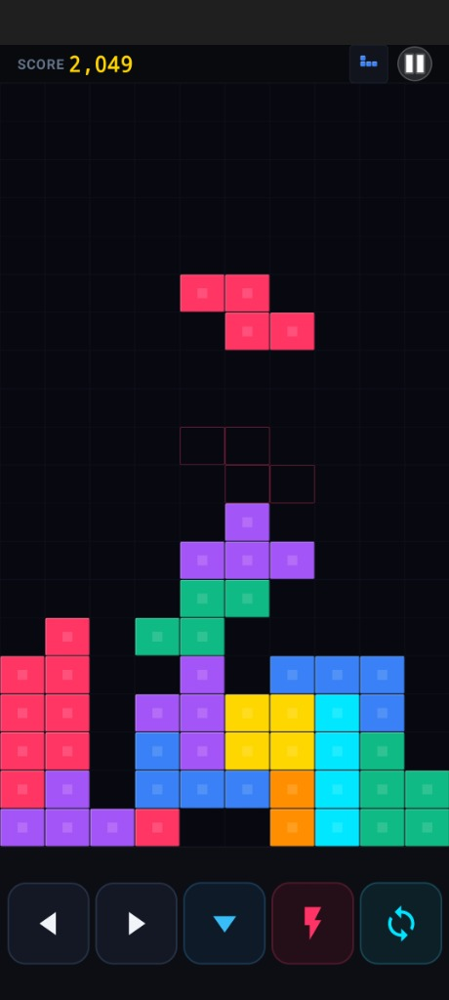

# 🕹️ Tetris Pro Native Android

A sleek, 100% pure native Android Tetris game built in Java with hardware-accelerated Canvas rendering, responsive touch controls, dynamic square buttons, authentic arcade audio, and zero web wrappers.

[](https://github.com/prabeshgupta/tetris-android/releases)
[-3DDC84?logo=android&logoColor=white)](https://github.com/prabeshgupta/tetris-android)
[](https://github.com/prabeshgupta/tetris-android)
[](LICENSE)

---

## 📱 Gameplay Screenshot

<p align="center">
  
</p>

---

## ✨ Features

- **⚡ 100% Pure Native Performance**: Built entirely in native Android Java (`SurfaceView`/`Canvas`) with hardware acceleration enabled. Zero WebViews, zero Cordova/Capacitor, zero lag.
- **📺 Edge-to-Edge 100% Canvas Width**: Board fills 100% of the device width with 0px vacant side margins, tailored for modern tall displays (FHD+ 20:9).
- **🎮 Ergonomic Square Controls**:
  - Dynamically sized 1:1 square buttons (~72dp square) providing +65% larger touch targets.
  - **0ms Instant Touch Response**: Drops and rotations trigger immediately on touch down (`ACTION_DOWN`).
  - **Tactile Feedback**: Vibrant glowing neon pressed state highlights and subtle haptic vibration on every tap.
  - **DAS (Delayed Auto Shift)**: Smooth, rapid piece shifting when holding left/right (55ms interval).
- **🎵 Retro Arcade Audio & SFX**:
  - Full-length **Arcade Stereo Band** arrangement of the classic Tetris theme.
  - Low-latency `SoundPool` sound effects for landing/locking pieces, line clears, 4-line Tetris fanfares, movement, and drops.
- **🎚️ Level Selector**: Customizable starting speed slider (Level 1 to Level 10) with real-time speed presets (1000ms down to 140ms per drop).
- **💎 Safe-Zone Adaptive Icon**: Custom 4-color gem T-piece icon padded within the 52% safe zone so launcher masks (circles/squircles) never crop the artwork.

---

## 📥 Download APK

Get the latest installable native APK from the Releases section:

👉 **[Download TetrisPro-Infinix-Hot60Pro.apk](https://github.com/prabeshgupta/tetris-android/releases/latest)**

### Installation Instructions
1. Download the `.apk` file to your Android device.
2. Tap the downloaded file in your browser or file manager.
3. If prompted, allow **"Install unknown apps"** for your browser.
4. Tap **Install** and enjoy!

---

## 🕹️ Controls Guide

| Button | Action | Behavior |
| :---: | :---: | :--- |
| **◀** | Move Left | Single tap or hold for rapid auto-shift (55ms) |
| **▶** | Move Right | Single tap or hold for rapid auto-shift (55ms) |
| **▼** | Soft Drop | Smooth accelerated drop with score bonus |
| **⚡** | Hard Drop | Instant piece drop & lock with 0ms touch latency |
| **↻** | Rotate | Instant 90° clockwise rotation with wall kicks |
| **⏸** | Pause / Resume | Pauses game loop and audio playback |

---

## 🛠️ Building from Source

This project can be built without Android Studio using standard Android SDK CLI tools:

```bash
# Prerequisites: JDK 17+, Android SDK (API 34/35), Build-Tools (AAPT2, D8, ZipAlign, Apksigner)
python build_apk.py
```

The output signed APK will be generated at `./TetrisPro-Infinix-Hot60Pro.apk`.

---

## 📄 License

This project is licensed under the MIT License - see the [LICENSE](LICENSE) file for details.
