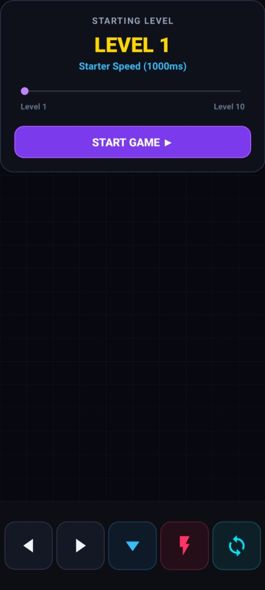
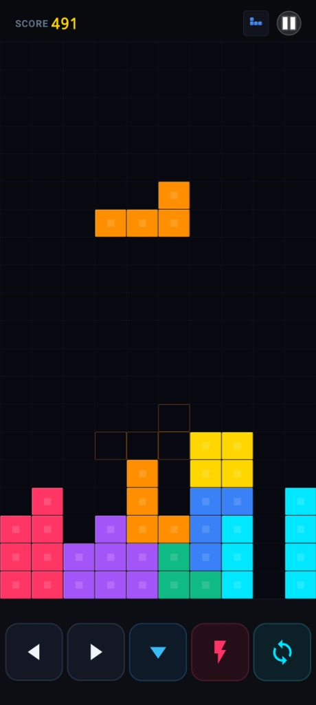

# 🕹️ BlockPro — Pure Native Android Game

A sleek, **100% Free, Zero Ads** pure native Android block puzzle game built in Java with hardware-accelerated Canvas rendering, responsive touch controls, dynamic square buttons, authentic arcade audio, and zero web wrappers.

[](https://github.com/prabeshgupta/blockpro/releases)
[](https://github.com/prabeshgupta/blockpro)
[-3DDC84?logo=android&logoColor=white)](https://github.com/prabeshgupta/blockpro)
[](https://github.com/prabeshgupta/blockpro)
[](LICENSE)

---

## 📱 Screenshots

<p align="center">
  
  
</p>

---

## ✨ Features

- 🚫 **100% Free & No Ads**: Completely ad-free, zero trackers, zero in-app purchases, fully offline playable.
- ⚡ **Pure Native Android Performance**: Built 100% in Java with native hardware-accelerated Canvas. No WebViews, no Cordova, zero lag.
- 📺 **Total Edge-to-Edge Fullscreen**: Zero gap at top, draws through the display cutout/notch, with board spanning 100% device width (0px side margins).
- 🎮 **Ergonomic Square Controls**:
  - Dynamically sized 1:1 square buttons (~72dp square) offering +65% larger touch area.
  - **0ms Instant Touch Down**: Hard Drop and Rotate trigger immediately on touch down (`ACTION_DOWN`).
  - **Tactile Feedback**: Glowing neon pressed states and subtle haptic vibration on every tap.
  - **DAS (Delayed Auto Shift)**: Fluid, rapid piece shifting when holding left/right (55ms interval).
- 🎵 **Arcade Stereo Soundtrack & SFX**:
  - Full-length **Arcade Stereo Band** arrangement loop.
  - Low-latency `SoundPool` sound effects for landing/locking pieces, line clears, 4-line fanfares, movement, and drops.
- 🎚️ **Customizable Starting Level**: Speed slider (Level 1 to Level 10) with real-time speed presets (1000ms down to 140ms per drop).
- 💎 **Safe-Zone Adaptive Icon**: 4-color gem T-piece icon padded within the 52% safe zone for all Android launchers.

---

## 📥 Download APK

Get the latest installable native APK from the Releases section:

👉 **[Download Blockpro.apk](https://github.com/prabeshgupta/blockpro/releases/latest/download/Blockpro.apk)**

### Installation Instructions
1. Download `Blockpro.apk` directly to your Android phone.
2. Tap the downloaded APK in your browser or file manager.
3. If prompted, allow **"Install unknown apps"** for your browser/file manager.
4. Tap **Install** and start playing!

---

## 🕹️ Controls Guide

| Button | Action | Behavior |
| :---: | :---: | :--- |
| **◀** | Move Left | Single tap or hold for rapid auto-shift (55ms DAS) |
| **▶** | Move Right | Single tap or hold for rapid auto-shift (55ms DAS) |
| **▼** | Soft Drop | Smooth accelerated drop with score bonus |
| **⚡** | Hard Drop | Instant piece drop & lock with 0ms touch latency |
| **↻** | Rotate | Instant 90° clockwise rotation with wall kicks |
| **⏸** | Pause / Resume | Pauses game loop and background music |

---

## 🛠️ Building from Source

This project builds cleanly using standard Android SDK CLI tools:

```bash
# Prerequisites: JDK 17+, Android SDK (API 34/35), Build-Tools (AAPT2, D8, ZipAlign, Apksigner)
python build_apk.py
```

The compiled and signed APK will be output at `./Blockpro.apk`.

---

## 📄 License

This project is licensed under the MIT License - see the [LICENSE](LICENSE) file for details.
